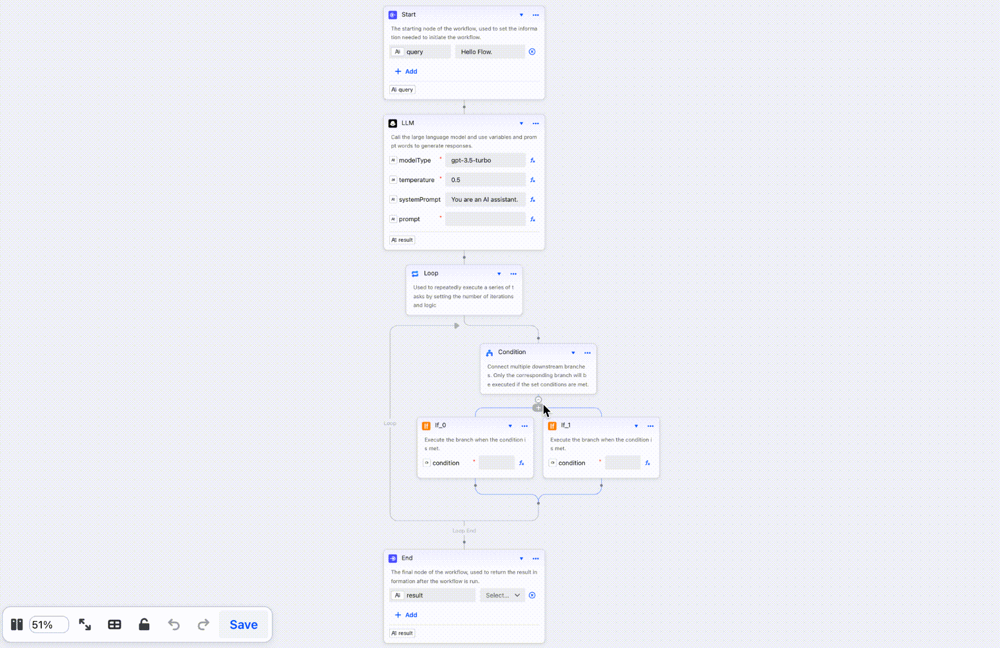
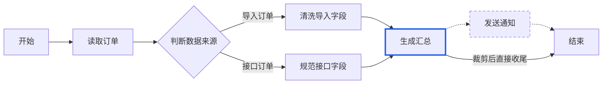

在工作流画布里改了一个「生成汇总」节点，我想拿一份实际输入试一下。点「运行整个流程」，后面的通知节点也可能跟着执行。单独跑汇总节点，又得自己构造一份和上游输出格式一致的数据。

我想要的是第三种操作：**从开始节点出发，让上游按工作流的规则提供输入，跑完我选的节点就收尾。**

这个按钮叫「运行到这里」。它背后的核心操作发生在执行前：后端先从原画布裁出一张调试子图。



*画布演示来自 [FlowGram 官方固定布局示例](https://flowgram.ai/examples/fixed-layout/fixed-feature-overview.html)。下面的订单流程是本文构造的示例。*

## 从目标节点往回找

假设我们在订单流程中选中「生成汇总」。



两条分支都可能给「生成汇总」提供数据，所以都要保留在调试子图里。至于本次走哪一条，仍然由「判断数据来源」根据输入决定。虚线标出的是原来通往通知节点的路径，裁剪后由「生成汇总」直接连到「结束」。

Go 后端先按边的目标节点 ID 建一个入边索引。然后从选中的节点出发，沿着入边一层层向上找。用一个集合记录已经见过的节点，两条路径汇到同一个上游时只处理一次。

```go
// 简化示意：incoming 按目标节点 ID 保存入边。
keep := map[string]bool{targetID: true}
queue := []string{targetID}

for len(queue) > 0 {
    current := queue[0]
    queue = queue[1:]

    for _, edge := range incoming[current] {
        upstream := edge.SourceNodeID
        if keep[upstream] {
            continue
        }

        keep[upstream] = true
        queue = append(queue, upstream)
    }
}
```

这一轮得到的是**沿画布连线能到达目标的上游节点**。如果这些节点里没有开始节点，后端就报错。在画布上能选中一个节点，只说明它存在。它还得能从开始节点走到，才可以用这种方式调试。

## 让目标节点接上一个有效的结束节点

找到要保留的节点之后，还有一处容易漏掉。原流程的结束节点可能引用「通知发送结果」。裁掉通知节点以后，那份输出配置就可能指向一个已经不存在的节点。

所以裁剪还要处理收尾：

1. 去掉目标节点原来的出边，以及原先连进结束节点的边，补一条「目标节点 → 结束」。
2. 清空结束节点原来的输入和输出配置，关闭它的流式输出，让它用调试子图的配置收尾。

服务把裁好的子图写进这次执行记录，作为画布快照，再交给已有的编译和流式执行入口。回头查看运行记录时，能看到当时实际用的是哪张图。裁剪发生在为这次运行解析出的画布对象上，下一次完整运行仍可读取工作流原来的画布。

## 为什么暂时不能停在分支里面？

把目标改成「清洗导入字段」，逆向遍历依然能找到「判断数据来源」和「开始」。

但如果这次输入是接口订单，条件节点实际会选中另一条分支，而那条分支已经被裁掉。强行切到导入分支，会改变条件节点在真实输入下的行为。

当前实现发现裁剪会丢掉上游条件节点的分支出口时，会提示选择分支汇合后的节点。循环也有自己的边界。可以选整个循环节点，或选循环之后的顶层节点。要支持停在循环体里的一步，还得先定义停在哪一轮、后续迭代如何处理，以及调试结果怎么返回。

这些约定也落到了测试里。直线流程要裁掉下游并重接结束节点，汇合点要保留两条分支，单选分支里的节点要报错，作为上游的循环要保留其内部结构。

## 回到画布上的那个按钮

点「生成汇总」上的「运行到这里」，订单照常读取，条件照常判断，命中的分支照常处理。汇总完成后，调试流程接上结束节点，发送通知这一步留在完整流程里。

**目标之前按原规则跑，目标之后的业务步骤从本次执行图里移除。** 把这条约定写进画布快照，下次排查问题时，执行记录也能回答一个很实用的问题：我这次到底跑了哪段流程？
