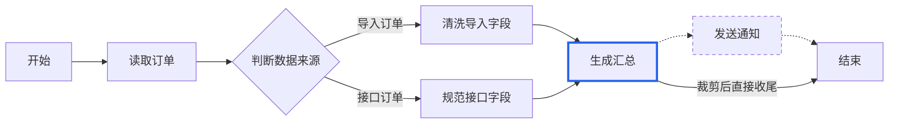

在工作流画布里改了一个「生成汇总」节点，我想拿一份实际输入试一下。点「运行整个流程」，后面的通知节点也可能跟着执行。单独跑汇总节点，又得自己构造一份和上游输出格式一致的数据。

我想要的是第三种操作：**从开始节点出发，让上游按工作流的规则提供输入，跑完我选的节点就收尾。**

这个按钮叫「运行到这里」。它背后的核心操作发生在执行前：后端先从原画布裁出一张调试子图。


*画布演示来自 [FlowGram 官方固定布局示例](https://flowgram.ai/examples/fixed-layout/fixed-feature-overview.html)。下面的订单流程是本文构造的示例。*

## 先确定这个按钮的含义

「运行到这里」最容易和「单节点试跑」混在一起。两者的区别，拿「生成汇总」这个节点就能讲清楚。

| 操作 | 输入怎么来 | 执行范围 |
| --- | --- | --- |
| 完整运行 | 从开始节点接收本次输入 | 按条件一路执行到原来的结束节点 |
| 单节点试跑 | 调试者给「生成汇总」提供样例输入 | 执行这个节点 |
| 运行到这里 | 从开始节点接收本次输入，上游重新计算 | 执行到「生成汇总」，然后进入调试结束节点 |

这里的“重新计算”很重要。假如上游要读数据库、调用 API，或者写入一条记录，本次调试依然会按原配置执行这些操作。**裁剪只缩小运行范围。** 这个例子省掉的是下游通知，上游如果有写操作，调试时也要留意输入和环境。

## 从目标节点往回找

假设我们在订单流程中选中「生成汇总」。



两条分支都可能给「生成汇总」提供数据，所以都要保留在调试子图里。至于本次走哪一条，仍然由「判断数据来源」根据输入决定。虚线标出的是原来通往通知节点的路径，裁剪后由「生成汇总」直接连到「结束」。

Go 后端先按边的目标节点 ID 建一个入边索引。然后从选中的节点出发，沿着入边一层层向上找。用一个集合记录已经见过的节点，两条路径汇到同一个上游时只处理一次。

```go
// 简化示意：incoming 按目标节点 ID 保存入边。
keep := map[string]bool{targetID: true}
queue := []string{targetID}

for len(queue) > 0 {
    current := queue[0]
    queue = queue[1:]

    for _, edge := range incoming[current] {
        upstream := edge.SourceNodeID
        if keep[upstream] {
            continue
        }

        keep[upstream] = true
        queue = append(queue, upstream)
    }
}
```

这一轮得到的是**沿画布连线能到达目标的上游节点**。如果这些节点里没有开始节点，后端就报错。在画布上能选中一个节点，只说明它存在。它还得能从开始节点走到，才可以用这种方式调试。

把示例代入代码，队列的变化就很直观：

1. 从「生成汇总」出发，找到「清洗导入字段」和「规范接口字段」。
2. 两个节点都指回「判断数据来源」。第一次遇到判断节点时把它加入队列，第二次发现它已经在集合里，就跳过。
3. 继续向上找到「读取订单」和「开始」。「发送通知」在目标的出边方向，逆向遍历不会访问到它。

这里保存的是**控制流上的上游节点**。即使「生成汇总」只引用了两个字段，也不能只凭字段名挑节点，因为「判断数据来源」还决定这两个字段会走哪条路径产生。建立入边索引和重建子图都只需线性扫描。按顶层节点数 V、边数 E 计算，这部分时间复杂度是 O(V + E)。

## 让目标节点接上一个有效的结束节点

找到要保留的节点之后，还有一处容易漏掉。原流程的结束节点可能引用「通知发送结果」。裁掉通知节点以后，那份输出配置就可能指向一个已经不存在的节点。

所以裁剪还要处理收尾：

1. 去掉目标节点原来的出边，以及原先连进结束节点的边，补一条「目标节点 → 结束」。
2. 清空结束节点原来的输入和输出配置，关闭它的流式输出，让它用调试子图的配置收尾。

服务把裁好的子图写进这次执行记录，作为画布快照，再交给已有的编译和流式执行入口。回头查看运行记录时，能看到当时实际用的是哪张图。裁剪发生在为这次运行解析出的画布对象上，下一次完整运行仍可读取工作流原来的画布。

一次运行大致经过这条链路：

```text
读取已保存的画布 → 裁成调试子图 → 保存执行快照 → 编译子图 → 流式返回执行事件
```

例如我今天把「生成汇总」选作目标，明天再把汇总节点移到循环里。查今天的记录时，应该按**今天执行过的子图**解释节点事件。保存快照还能让排查更具体：如果「发送通知」根本没出现在快照里，就知道它在执行前已经被裁掉。如果节点出现在快照里，才需要接着查它是否被分支跳过、有没有报错。这两个问题可以分别从图和事件里找答案。

## 为什么暂时不能停在分支里面？

把目标改成「清洗导入字段」，逆向遍历依然能找到「判断数据来源」和「开始」。

但如果这次输入是接口订单，条件节点实际会选中另一条分支，而那条分支已经被裁掉。强行切到导入分支，会改变条件节点在真实输入下的行为。

当前实现发现裁剪会丢掉上游条件节点的分支出口时，会提示选择分支汇合后的节点。循环也有自己的边界。可以选整个循环节点，或选循环之后的顶层节点。要支持停在循环体里的一步，还得先定义停在哪一轮、后续迭代如何处理，以及调试结果怎么返回。

### 用测试约束裁剪结果

这部分测试直接给裁剪函数传入一张小画布，再检查返回的节点、连线或错误。这样改动裁剪逻辑时，可以先看哪条图结构约定被破坏。

| 测试场景 | 检查什么 |
| --- | --- |
| 直线流程，中间节点设为目标 | 下游节点被移除，目标直接连到结束节点，结束方式切换为返回变量 |
| 目标位于两条分支汇合处 | 判断节点和两条分支都留在子图里 |
| 目标仅在一条条件分支内 | 返回明确的分支错误 |
| 循环整体位于目标上游 | 保留循环节点及其内部块 |
| 目标位于循环体内部 | 返回明确的循环体错误 |

尤其值得留的是直线流程里对**最后一条边**的断言。只检查下游节点消失，可能漏掉「目标节点已经跑完，图却接不上结束节点」的问题。直接检查这条边，就能把停止位置写成可验证的约定。

## 回到画布上的那个按钮

点「生成汇总」上的「运行到这里」，订单照常读取，条件照常判断，命中的分支照常处理。汇总完成后，调试流程接上结束节点，发送通知这一步留在完整流程里。

**目标之前按原规则跑，目标之后的业务步骤从本次执行图里移除。** 把这条约定写进画布快照，下次排查问题时，执行记录也能回答一个很实用的问题：我这次到底跑了哪段流程？
